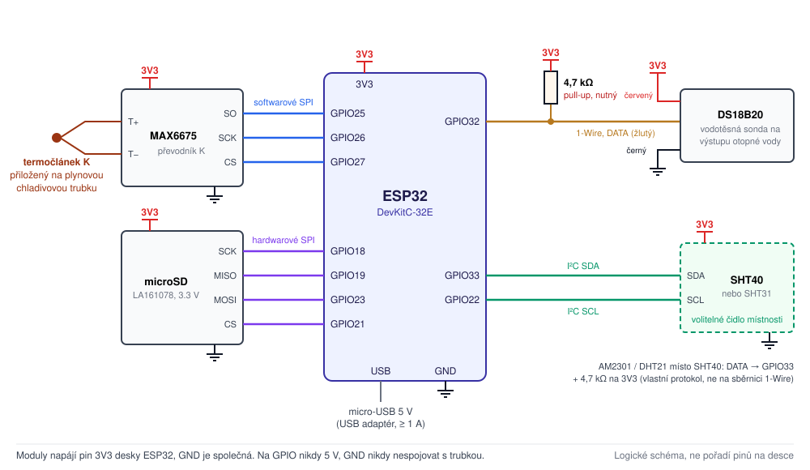
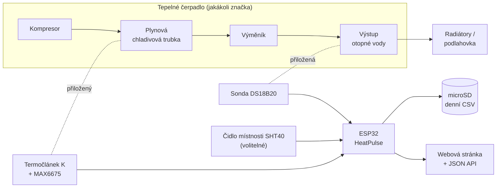

# HeatPulse

[English](README.md) | **Česky**

**Univerzální příložný monitor pro jakékoli tepelné čerpadlo.** HeatPulse je malý logger na ESP32, který měří teplotu dvou trubek: **plynové chladivové trubky** a **výstupu otopné vody**. Z nich pozná, kdy běží kompresor, jak často startuje a jak dlouho který běh trvá. Vše zapisuje na microSD kartu a ukazuje na webové stránce v domácí síti. Nepotřebuje cloud, aplikaci výrobce ani žádné připojení k tepelnému čerpadlu.

<p align="center">
  
</p>

## Proč HeatPulse

Tepelné čerpadlo může běžet úsporně, nebo **krátce cyklovat**: naskočí, pár minut běží, vypne a zase naskočí. Každý start ubírá účinnost a opotřebovává kompresor. Nejčastější příčiny jsou zbytečně vysoká teplota otopné vody, přivřené termostatické hlavice, malý objem vody v soustavě nebo předimenzovaná jednotka. Většina majitelů to ale nemá jak zjistit:

- **Regulace ukazuje okamžitý stav, ne historii.** Uvidíte, že kompresor právě běží, ale ne že včera startoval čtyřicetkrát.
- **Aplikace a cloudy výrobců jsou uzavřené a pro každou značku jiné.** Detaily často skrývají a mohou přestat fungovat.
- **Čtení přímo z regulace** (Modbus, servisní port, zásah do jednotky) se u každého modelu liší, může ohrozit záruku a není to práce pro běžného majitele.

HeatPulse na to jde opačně. **Dotýká se jen povrchu trubek**: jedno čidlo je přiložené na plynovou chladivovou trubku, druhé na výstup otopné vody. Nic v něm nezávisí na značce, takže stejný hardware i firmware by měl fungovat s **Gree, Daikin, Panasonic, Mitsubishi, Samsung, LG, NIBE, Vaillant i jakýmkoli jiným tepelným čerpadlem**, pokud je plynová trubka bezpečně přístupná (typicky u splitu mezi venkovní a vnitřní jednotkou). Data zůstávají na vaší SD kartě a ve vaší síti jako obyčejné CSV soubory, které otevřete v tabulkovém editoru.

Hodí se na otázky jako:

- Kolikrát za hodinu a za den kompresor startuje a jak dlouhé jsou běhy?
- Pomohlo snížení ekvitermní křivky, otevření hlavic nebo akumulační nádrž?
- Cykluje jednotka v mírném počasí, nebo v mrazu běží nepřetržitě a nestíhá?
- *(volitelné čidlo místnosti)* Co se děje v místnosti s tepelným čerpadlem, např. ve sklepě před zateplením a po něm?

> [!IMPORTANT]
> HeatPulse tepelné čerpadlo **neovládá** a **elektricky se k němu nepřipojuje**. Stav kompresoru je **odhad z teploty trubky**. Při odmrazování a ohřevu TUV může být chybný. Neměří frekvenci kompresoru, tepelný výkon ani COP.

## Jak to funguje



Když kompresor běží, proudí plynovou trubkou horký stlačený plyn a její povrch se během minuty dvou ohřeje. Když se kompresor zastaví, trubka zase chladne. HeatPulse měří trubku každých 10 s a podle dvou prahů s hysterezí určuje, zda kompresor **běží (teplá fáze)**, nebo **stojí (chladná fáze)**. Detektor rychlosti nárůstu teploty datuje každý start s přesností asi 20–30 s. Z fází počítá starty za hodinu a za den, délky běhů a přestávek a každý běh hodnotí jako *špatný / přijatelný / dobrý / ideální* podle publikovaných studií o cyklování.

Prahy se nastavují na webové stránce, protože každé tepelné čerpadlo i místo měření je jiné. Viz [jak prahy nastavit](docs/cs/pouzivani.md#jak-prahy-nastavit).

## Co umí

- **Měření každých 10 s:** plynová chladivová trubka (termočlánek K, MAX6675) a výstup otopné vody (DS18B20).
- **Odhad chodu kompresoru:** starty za 1 h a 24 h, průměrné délky běhů a přestávek, hodnocení délky běhů, brzká detekce startu z nárůstu teploty.
- **Volitelné čidlo místnosti** (Sensirion SHT40 / SHT31, nebo AM2301 / DHT21): teplota, relativní a absolutní vlhkost, rosný bod a denní vývoj min/průměr/max až za rok.
- **Webová stránka bez cloudu a CDN:** aktuální hodnoty, grafy za 24 h s popisky, statistiky startů, stav úložiště, stažení CSV a nastavení prahů. Funguje i na mobilu.
- **Spolehlivé ukládání:** denní CSV soubory a soubor událostí na microSD, zapisované z tříhodinového RAM bufferu každých 10 minut. Zápis se ověřuje, karta se automaticky znovu připojí a staré soubory se mažou kruhově ([podrobnosti](#ukládání-dat)).
- **JSON API** pro vlastní skripty, Home Assistant, Grafanu apod.
- **Síť:** čas z NTP, bez internetu z prohlížeče. Když domácí Wi-Fi není dostupná, spustí vlastní Wi-Fi.

## Potřebný hardware

Díly stojí jednotky stovek korun a skoro nic se nepájí. Poslouží i jiné rovnocenné moduly, odkazy vedou na otestované díly.

| Díl | Poznámka |
|---|---|
| ESP32-DevKitC-32E V4 (ESP-WROOM-32E) | jiné desky ESP32 fungují po úpravě pinů |
| Modul MAX6675 + termočlánek K, např. sada [LaskaKit LA131099](https://www.laskakit.cz/prevodnik-max6675-termoclanek-typu-k-800c-m6-0-5m/) (sonda M6, 0,5 m) | tělo M6 a kovový oplet mohou být spojené s měřicím spojem, proto [ho ověřte a odizolujte](docs/cs/montaz-cidel.md#elektrická-izolace-termočlánku) |
| DS18B20, vodotěsná sonda, např. [LaskaKit LA131090](https://www.laskakit.cz/dallas-digitalni-vodotesne-cidlo-teploty-ds18b20-3m/) (3 m) | |
| **Rezistor 4,7 kΩ / 0,25 W** (tolerance 5 % stačí) | **nutný** pull-up pro DS18B20, sonda LA131090 ho nemá |
| *volitelně:* [modul LaskaKit SHT40 LA131037](https://www.laskakit.cz/laskakit-sht40-senzor-teploty-a-vlhkosti-vzduchu/) | teplota a vlhkost místnosti, přesná i ve vlhkém sklepě, I²C. Podporováno i: sonda SHT31 v krytu (DFRobot SEN0385), AM2301 / DHT21 |
| [LaskaKit microSD modul LA161078](https://www.laskakit.cz/laskakit-microsd-card-modul/) | 3,3 V |
| microSD karta 4–32 GB, FAT32 | 8 GB bohatě stačí |
| USB adaptér 5 V / 1 A + datový micro-USB kabel | |
| Propojovací vodiče, plastová krabička, objímky na trubku, teplovodivá pasta, izolace trubek | |

## Zapojení

Všechny moduly jsou napájené **3,3 V z pinu `3V3` desky ESP32** a mají společnou `GND`. Samotné ESP32 se napájí přes micro-USB.

| Modul | Zapojení na ESP32 |
|---|---|
| MAX6675 | VCC→3V3, GND→GND, SCK→GPIO26, CS→GPIO27, SO→GPIO25 |
| microSD LA161078 | 3V3→3V3, GND→GND, SCK→GPIO18, MISO→GPIO19, MOSI→GPIO23, CS→GPIO21 |
| DS18B20 LA131090 | červený→3V3, černý→GND, žlutý→GPIO32, **rezistor 4,7 kΩ mezi GPIO32 a 3V3** |
| SHT40 / SHT31 (volitelné) | VCC→3V3, GND→GND, SDA→GPIO33, SCL→GPIO22 |
| AM2301 / DHT21 (volitelné, místo SHT) | červený→3V3, černý→GND, žlutý→GPIO33, 4,7 kΩ mezi GPIO33 a 3V3 |

Totéž zapojení ukazuje schéma nahoře. Podrobný [návod k zapojení](docs/cs/zapojeni.md) má detailnější schémata, poznámky ke každému čidlu a test na stole. Piny lze změnit konstantami `PIN_*` na začátku firmwaru.

## Rychlý start

1. **Zapojte** moduly podle schématu a otestujte je na stole ([zapojení](docs/cs/zapojeni.md#test-na-stole)).
2. **Nainstalujte** Arduino IDE, jádro ESP32 3.x a knihovny OneWire + DallasTemperature ([instalace](docs/cs/instalace.md)).
3. Zkopírujte `firmware/HeatPulse/secrets.example.h` jako `secrets.h` a vyplňte Wi-Fi (2,4 GHz).
4. Nahrajte `firmware/HeatPulse/HeatPulse.ino` do ESP32 (deska *ESP32 Dev Module*) a v Serial Monitoru (115200 baud) zjistěte IP adresu.
5. Otevřete IP adresu v prohlížeči. Teprve když vše funguje, **namontujte čidla** na trubky ([montáž čidel](docs/cs/montaz-cidel.md)).
6. **Nastavte prahy** pro své tepelné čerpadlo: sledujte pár startů a zastavení a podle nich nastavte práh teplé a chladné fáze ([používání](docs/cs/pouzivani.md#jak-prahy-nastavit)).

## Data

- **Denní CSV** `/LOGS/YYYYMMDD.CSV`: řádek každých 10 s s oběma teplotami, odhadem chodu kompresoru a hodnotami čidla místnosti.
- **Události** `EVENTS.CSV`: každý start a zastavení s délkou skončené fáze.
- **Souhrn místnosti** `CELLAR.CSV`: řádek za každý den s min/průměrem/max teploty a vlhkosti.
- **HTTP API**: `GET /api/status`, `/api/history`, `/api/cellar`, `/api/files`, stažení CSV přes `/download?file=…`, `/events.csv`, `/cellar.csv`.

[Formát CSV](docs/cs/pouzivani.md#data-na-microsd-csv) a [HTTP API](docs/cs/pouzivani.md#http-api) jsou popsané v dokumentu Používání.

## Ukládání dat

- **Karta nezpomaluje měření.** Řádek každých 10 s jde do RAM bufferu (kapacita 3 hodiny) a web se aktualizuje okamžitě. Samostatná úloha zapisuje buffer na microSD **každých 10 minut**, každý řádek s původní časovou značkou do souboru dne, kdy byl změřen.
- **Ověřovaný zápis bez duplicit:** kontroluje se otevření, zápis, flush, `fsync`, zavření i velikost souboru. Řádky se z RAM uvolní až po úspěšném zápisu. Částečný neúspěšný zápis se před opakováním odřízne.
- **Vyjmutá nebo vadná karta:** měření i web běží dál a data čekají v RAM, dokud karta znovu nefunguje (pokus o připojení každých 60 s).
- **Kruhový archiv:** pod 10 % volného místa se mažou nejstarší denní soubory, ale jen starší než 365 dní. Novější data se automaticky nikdy nemažou.

> [!NOTE]
> **Výpadek napájení:** řádky, které jsou ještě v RAM, se ztratí, **nejvýše přibližně posledních 10 minut**. Před odpojením loggeru stiskněte na webu *Write buffer to microSD now*.

Podrobnosti jsou v [ukládání dat](docs/cs/uloziste.md), testovací postupy v [testování](docs/cs/testovani.md).

## Dokumentace

| Dokument | Obsah |
|---|---|
| [Zapojení](docs/cs/zapojeni.md) | schémata, tabulky pinů, rezistor pro DS18B20, čidlo místnosti (SHT40 / SHT31 / AM2301), test na stole |
| [Montáž čidel a bezpečnost](docs/cs/montaz-cidel.md) | kam dát termočlánek a DS18B20, elektrická izolace, zvláštnosti čidel |
| [Instalace firmwaru](docs/cs/instalace.md) | Arduino IDE, `secrets.h`, nahrání, Wi-Fi |
| [Používání](docs/cs/pouzivani.md) | webová stránka, prahy, čidlo místnosti, formát CSV, HTTP API |
| [Ukládání dat](docs/cs/uloziste.md) | RAM buffer, zápis na microSD, kruhový archiv, chování při poruchách, diagnostika |
| [Testování](docs/cs/testovani.md) | testovací scénáře: běžný provoz, málo volného místa, neúspěšný zápis, půlnoc, obnovení |
| [Cyklování tepelného čerpadla](docs/cs/cyklovani.md) | ztráty při startu, ideální délka běhu, teplota vody a účinnost, A/B test |
| [Poznámky ke Gree Versati III](docs/cs/gree-versati-iii.md) | specifika modelu: ekvitermní křivka, řízení kompresoru, údaje výrobce |
| [Řešení problémů](docs/cs/reseni-problemu.md) | nejčastější potíže a co zkontrolovat |
| [Plán rozvoje](docs/cs/plan-rozvoje.md) | nápady na další verze |
| [Zdroje](docs/cs/zdroje.md) | datasheety, manuály a studie |

Anglická dokumentace je v [`docs/`](docs/).

## Bezpečnost

- Nic nepřipojujte na svorky tepelného čerpadla ani jeho regulace. Nezasahujte do rozvaděče 400 V ani do chladivového okruhu.
- Termočlánek se závitem M6 se do potrubí **nešroubuje**, jen přikládá. Potrubí nevrtejte, nepájejte ani neohýbejte.
- Zem elektroniky nespojujte s potrubím a ověřte izolaci termočlánku.
- Webové rozhraní nemá přihlašování, proto ho **nevystavujte do internetu**.

Montáž provádíte na vlastní odpovědnost. Podrobnosti jsou v [montáži čidel](docs/cs/montaz-cidel.md).

## Omezení

- Stav kompresoru se odvozuje z teploty. Splést ho může odmrazování, ohřev TUV nebo oběhové čerpadlo, které žene teplou vodu, a hodně záleží na [prazích](docs/cs/pouzivani.md#jak-prahy-nastavit).
- Neměří venkovní teplotu, frekvenci kompresoru, příkon ani tepelný výkon, takže nespočítá COP.
- Monoblok má chladivový okruh uvnitř venkovní jednotky. Plynová trubka tam obvykle není bezpečně přístupná a sledovat lze jen stranu vody.

## Struktura repozitáře

```
├── firmware/HeatPulse/
│   ├── HeatPulse.ino          # firmware pro ESP32 (Arduino)
│   └── secrets.example.h      # vzor přístupových údajů k Wi-Fi
├── docs/                      # dokumentace (anglicky)
│   ├── cs/                    # dokumentace (česky)
│   └── img/                   # schémata
├── .github/workflows/         # kontrola překladu firmwaru (GitHub Actions)
├── CHANGELOG.md
└── LICENSE
```

## Stav projektu a zapojení do vývoje

Firmware verze **2.3** pro Arduino-ESP32 core 3.x (překlad ověřen s 3.3.12, OneWire 2.3.8, DallasTemperature 4.0.6, deska *ESP32 Dev Module*). GitHub Actions firmware přeloží při každém pushi. Denně běží na instalaci Gree Versati III Split. **Velmi uvítáme zkušenosti s jinými značkami:** na kterou trubku jste měřili, jaké prahy fungovaly a jak dobře odhad seděl se skutečným chodem kompresoru. Založte issue nebo pull request. Přehled změn (anglicky) je v [CHANGELOG.md](CHANGELOG.md).

## Licence

[MIT](LICENSE)
