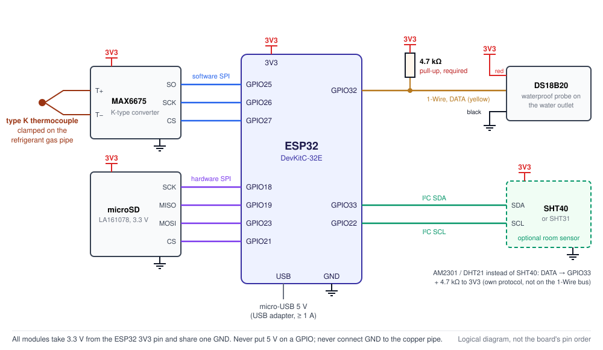
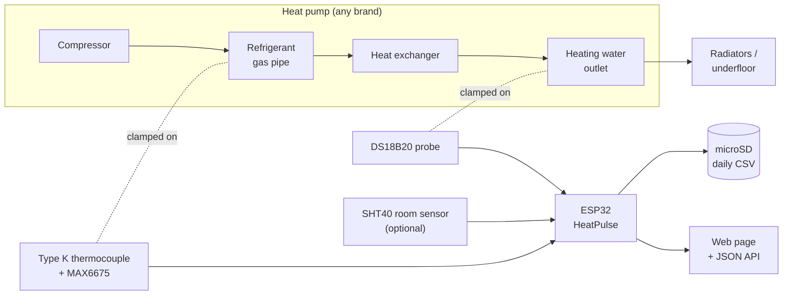

# HeatPulse

**English** | [Česky](README.cs.md)

**A universal, clamp-on monitor for any heat pump.** HeatPulse is a small ESP32 logger that reads two pipe temperatures, the **refrigerant gas pipe** and the **heating water outlet**. From them it works out when the compressor runs, how often it starts and how long each run lasts. Everything is logged to a microSD card and shown on a local web page. It needs no cloud, no vendor app and no connection to the heat pump.

<p align="center">
  
</p>

## Why HeatPulse

A heat pump can run efficiently, or it can **short cycle**: start, run for a few minutes, stop, and start again. Every start costs efficiency and wears the compressor. The usual causes are a flow temperature set higher than needed, closed thermostatic valves, low water volume or an oversized unit. Most owners have no easy way to see it:

- **Controllers show the present state, not the history.** You can see that the compressor runs now, but not that it started 40 times yesterday.
- **Vendor apps and cloud dashboards are closed and brand-specific.** They often hide the details, they may stop working, and every brand has its own.
- **Reading the controller directly** (Modbus, service port, wiring into the unit) differs per model, may void the warranty, and is not something most owners should do.

HeatPulse takes the opposite approach. It **only touches the outside of the pipes**: one sensor is clamped on the refrigerant gas pipe and one on the water outlet. Nothing in it depends on the brand, so the same hardware and firmware should work with **Gree, Daikin, Panasonic, Mitsubishi, Samsung, LG, NIBE, Vaillant or any other heat pump**, as long as the hot gas pipe can be reached safely (typically on a split system, between the outdoor unit and the indoor unit). Your data stays on your own SD card and local network, as plain CSV files you can open in a spreadsheet.

It is made for questions like:

- How many times per hour and per day does my compressor start, and how long are the runs?
- Did lowering the weather compensation curve, opening the TRVs or adding a buffer tank help?
- Does the unit cycle in mild weather, or run continuously and struggle in frost?
- *(optional room sensor)* What does the room around the heat pump do, e.g. a cellar before and after insulation?

> [!IMPORTANT]
> HeatPulse **does not control** the heat pump and has **no electrical connection** to it. The compressor state is an **estimate from the pipe temperature**. It can be wrong during defrosting and domestic hot water heating. It does not measure compressor frequency, heat output or COP.

## How it works



While the compressor runs, hot compressed gas flows through the gas pipe and its surface heats up within a minute or two. When the compressor stops, the pipe cools down again. HeatPulse samples the pipe every 10 s and uses two thresholds with hysteresis to decide whether the compressor is **running (hot phase)** or **stopped (cold phase)**. A detector that watches how fast the temperature rises dates each start to within about 20–30 s. From the phases it counts starts per hour and per day, measures run and pause lengths, and rates each run as *poor / acceptable / good / ideal* using published research on cycling.

The thresholds are set on the web page because every heat pump and mounting point is different. See [how to tune the thresholds](docs/usage.md#how-to-tune-the-thresholds).

## Features

- **Measurement every 10 s:** refrigerant gas pipe (type K thermocouple, MAX6675) and heating water outlet (DS18B20).
- **Compressor estimate:** starts per 1 h and 24 h, average run and pause lengths, run length rating, early start detection from the temperature rise.
- **Optional room sensor** (Sensirion SHT40 / SHT31, or AM2301 / DHT21): temperature, relative and absolute humidity, dew point and a daily min/avg/max trend over up to a year.
- **Local web page with no cloud or CDN:** live values, 24 h charts with tooltips, start statistics, storage status, CSV download and threshold settings. It works on a phone too.
- **Reliable logging:** daily CSV files plus an event file on microSD, written from a 3-hour RAM buffer every 10 minutes. Writes are verified, the card is remounted automatically and old files are archived in a circle ([details](#data-storage)).
- **JSON API** for your own scripts, Home Assistant, Grafana and so on.
- **Network:** time from NTP, or from the browser without internet. When the home Wi-Fi is not available, it opens its own access point.

## Hardware

The parts cost a few tens of euros and need little or no soldering. Any equivalent modules will do. The links are the tested parts.

| Part | Note |
|---|---|
| ESP32-DevKitC-32E V4 (ESP-WROOM-32E) | other ESP32 boards work after adjusting the pins |
| MAX6675 module + type K thermocouple, e.g. the [LaskaKit LA131099](https://www.laskakit.cz/prevodnik-max6675-termoclanek-typu-k-800c-m6-0-5m/) kit (M6 probe, 0.5 m) | the M6 body and metal braid may be connected to the junction, so [check and isolate it](docs/sensor-mounting.md#electrical-isolation-of-the-thermocouple) |
| DS18B20 waterproof probe, e.g. [LaskaKit LA131090](https://www.laskakit.cz/dallas-digitalni-vodotesne-cidlo-teploty-ds18b20-3m/) (3 m) | |
| **4.7 kΩ / 0.25 W resistor** (5 % tolerance is fine) | **required** pull-up for the DS18B20. The LA131090 probe does not include one |
| *optional:* [LaskaKit SHT40 module LA131037](https://www.laskakit.cz/laskakit-sht40-senzor-teploty-a-vlhkosti-vzduchu/) | room temperature and humidity, accurate even in a damp cellar, on I²C. Also supported: SHT31 probe in a housing (DFRobot SEN0385), AM2301 / DHT21 |
| [LaskaKit microSD module LA161078](https://www.laskakit.cz/laskakit-microsd-card-modul/) | 3.3 V |
| microSD card 4–32 GB, FAT32 | 8 GB is plenty |
| 5 V / 1 A USB adapter + data micro-USB cable | |
| Jumper wires, plastic enclosure, pipe clips, thermal paste, pipe insulation | |

## Wiring

All modules run on **3.3 V from the ESP32 `3V3` pin** and share one `GND`. The ESP32 itself is powered over micro-USB.

| Module | ESP32 connection |
|---|---|
| MAX6675 | VCC→3V3, GND→GND, SCK→GPIO26, CS→GPIO27, SO→GPIO25 |
| microSD LA161078 | 3V3→3V3, GND→GND, SCK→GPIO18, MISO→GPIO19, MOSI→GPIO23, CS→GPIO21 |
| DS18B20 LA131090 | red→3V3, black→GND, yellow→GPIO32, **4.7 kΩ resistor between GPIO32 and 3V3** |
| SHT40 / SHT31 (optional) | VCC→3V3, GND→GND, SDA→GPIO33, SCL→GPIO22 |
| AM2301 / DHT21 (optional, instead of SHT) | red→3V3, black→GND, yellow→GPIO33, 4.7 kΩ between GPIO33 and 3V3 |

The diagram at the top shows the same connections. The full [wiring guide](docs/wiring.md) has more detailed diagrams, notes on each sensor and a bench test. Pins can be changed with the `PIN_*` constants at the top of the firmware.

## Quick start

1. **Wire** the modules as shown above and test them on the bench ([wiring](docs/wiring.md#bench-test)).
2. **Install** the Arduino IDE, the ESP32 core 3.x and the OneWire + DallasTemperature libraries ([installation](docs/installation.md)).
3. Copy `firmware/HeatPulse/secrets.example.h` to `secrets.h` and fill in your Wi-Fi (2.4 GHz).
4. Upload `firmware/HeatPulse/HeatPulse.ino` to the ESP32 (board *ESP32 Dev Module*) and find its IP address in the Serial Monitor (115200 baud).
5. Open the IP address in a browser. Only when everything works, **mount the sensors** on the pipes ([sensor mounting](docs/sensor-mounting.md)).
6. **Tune the thresholds** for your heat pump: watch a few starts and stops and set the hot and cold thresholds ([usage](docs/usage.md#how-to-tune-the-thresholds)).

## Data

- **Daily CSV** `/LOGS/YYYYMMDD.CSV`: one row every 10 s with both temperatures, the compressor estimate and the room sensor values.
- **Events** `EVENTS.CSV`: each start and stop with the length of the phase that ended.
- **Room summary** `CELLAR.CSV`: one row per day with min/avg/max temperature and humidity.
- **HTTP API**: `GET /api/status`, `/api/history`, `/api/cellar`, `/api/files`, CSV download via `/download?file=…`, `/events.csv`, `/cellar.csv`.

The [CSV format](docs/usage.md#data-on-the-microsd-card-csv) and the [HTTP API](docs/usage.md#http-api) are described in usage.

## Data storage

- **The card does not slow down measuring.** Each 10 s row goes into a RAM buffer (3 hours of capacity), and the web page updates immediately. A separate task writes the buffer to microSD **every 10 minutes**, each row with its original time stamp and into the file of the day it was measured.
- **Verified writes, no duplicates:** open, write, flush, `fsync`, close and the file size are all checked. Rows leave RAM only after a successful write. A partial failed write is cut off before the retry.
- **Card removed or broken:** measuring and the web page keep running, and the data wait in RAM until the card works again (remount every 60 s).
- **Circular archive:** below 10 % free space the oldest daily files are deleted, but only files older than 365 days. Newer data are never deleted automatically.

> [!NOTE]
> **Power cut:** the rows still in RAM are lost, **at most about the last 10 minutes**. Press *Write buffer to microSD now* on the web page before unplugging the logger.

Details are in [data storage](docs/storage.md), test procedures in [testing](docs/testing.md).

## Documentation

| Document | Contents |
|---|---|
| [Wiring](docs/wiring.md) | diagrams, pin tables, DS18B20 resistor, room sensor (SHT40 / SHT31 / AM2301), bench test |
| [Sensor mounting and safety](docs/sensor-mounting.md) | where to put the thermocouple and the DS18B20, electrical isolation, sensor quirks |
| [Firmware installation](docs/installation.md) | Arduino IDE, `secrets.h`, upload, Wi-Fi |
| [Usage](docs/usage.md) | web interface, thresholds, room sensor, CSV format, HTTP API |
| [Data storage](docs/storage.md) | RAM buffer, writing to microSD, circular archive, behaviour on failures, Serial diagnostics |
| [Testing](docs/testing.md) | test scenarios: normal operation, low free space, failed write, midnight, recovery |
| [Heat pump cycling](docs/heat-pump-cycling.md) | start-up losses, ideal run length, flow temperature and efficiency, A/B testing |
| [Gree Versati III notes](docs/gree-versati-iii.md) | model-specific notes: weather compensation curve, compressor control, manufacturer data |
| [Troubleshooting](docs/troubleshooting.md) | common problems and what to check |
| [Roadmap](docs/roadmap.md) | ideas for future versions |
| [References](docs/references.md) | datasheets, manuals and research |

Czech documentation is in [`docs/cs/`](docs/cs/).

## Safety

- Do not connect anything to the terminals of the heat pump or its controller. Do not work inside the 400 V switchboard or on the refrigerant circuit.
- The M6 threaded thermocouple is **not screwed into** the pipe, only clamped on. Do not drill, solder or bend the pipe.
- Do not connect the electronics ground to the pipe, and check the thermocouple's isolation.
- The web interface has no login, so **do not expose it to the internet**.

You install the sensors at your own risk. See [sensor mounting](docs/sensor-mounting.md) for details.

## Limitations

- The compressor state is inferred from temperature. Defrosting, domestic hot water heating and a circulation pump moving warm water can confuse it, and the [thresholds](docs/usage.md#how-to-tune-the-thresholds) matter.
- It does not read the outdoor temperature, the compressor frequency, the power input or the heat output, so it cannot calculate COP.
- Monoblock units have the refrigerant circuit inside the outdoor unit. There the gas pipe is usually not safely reachable, and only the water side can be monitored.

## Repository layout

```
├── firmware/HeatPulse/
│   ├── HeatPulse.ino          # ESP32 firmware (Arduino)
│   └── secrets.example.h      # Wi-Fi credentials template
├── docs/                      # documentation (English)
│   ├── cs/                    # documentation (Czech)
│   └── img/                   # diagrams
├── .github/workflows/         # firmware build check (GitHub Actions)
├── CHANGELOG.md
└── LICENSE
```

## Project status and contributing

Firmware version **2.3** for the Arduino-ESP32 core 3.x (built with 3.3.12, OneWire 2.3.8, DallasTemperature 4.0.6, board *ESP32 Dev Module*). GitHub Actions builds the firmware on every push. It runs every day on a Gree Versati III split installation. **Reports from other brands are very welcome:** which pipe you measured, which thresholds worked, and how well the estimate matched the real compressor state. Open an issue or a pull request. See [CHANGELOG.md](CHANGELOG.md) for the changes.

## License

[MIT](LICENSE)
