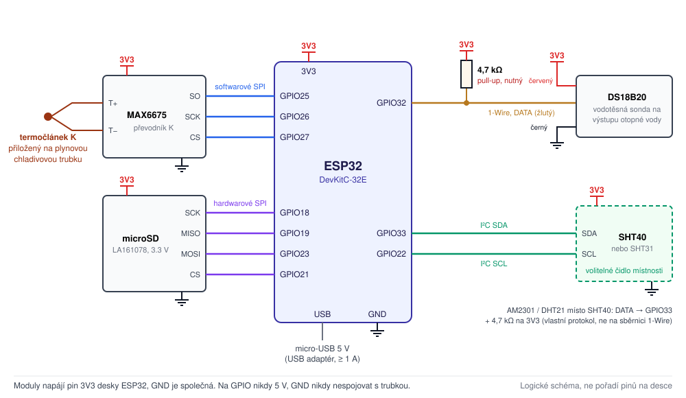

# Zapojení

ESP32-DevKitC-32E + MAX6675 + LaskaKit microSD LA161078 + DS18B20 (LaskaKit LA131090) + volitelné čidlo teploty a vlhkosti místnosti (doporučené SHT40, nebo AM2301).



## Napájení

ESP32 se napájí **5 V přes micro-USB** z běžného USB adaptéru (alespoň 1 A). Všechny moduly berou **3,3 V z pinu `3V3`** na ESP32 a mají společnou zem `GND`.

```
                         USB adaptér 5 V / 1–2 A
                                   |
                            micro-USB kabel
                                   |
                           ESP32-DevKitC-32E
                         (stabilizátor 3,3 V)
                                   |
                 +-----------------+-----------------+
                 |                 |                 |
                3V3               3V3               3V3
                 |                 |                 |
              MAX6675           microSD        DS18B20 (VDD)
                 |                 |                 |
                GND               GND               GND
                 +-----------------+-----------------+
                                   |
                              GND na ESP32

DS18B20 DQ (žlutý) ----+---- GPIO32
                       |
                    [4,7 kΩ]
                       |
                      3V3

Čidlo místnosti (volitelné), jedno z:
  modul SHT40:   VCC -> 3V3, GND -> GND, SDA -> GPIO33, SCL -> GPIO22   (pull-upy na modulu)
  AM2301:        červený -> 3V3, černý -> GND, žlutý -> GPIO33 + [4,7 kΩ] na 3V3   (ne na sběrnici DS18B20)

MAX6675: SCK=GPIO26, CS=GPIO27, SO=GPIO25
microSD: SCK=GPIO18, MISO=GPIO19, MOSI=GPIO23, CS=GPIO21
```

> [!WARNING]
> Na GPIO piny ESP32 nikdy nepřivádějte 5V signál. Nepřipojujte externí 3,3 V současně s napájením z USB.

> [!CAUTION]
> Společná `GND` je pouze zem elektroniky. **Nepřipojujte ji záměrně k měděnému chladivovému potrubí.** Ověřte, zda měřicí spoj termočlánku není vodivě spojený s jeho kovovým tělem – zvlášť když je ESP32 připojené přes USB k notebooku. Podrobnosti v [montáži čidel](montaz-cidel.md).

## MAX6675 + termočlánek K

| MAX6675 | ESP32 |
|---|---|
| VCC | 3V3 |
| GND | GND |
| SCK | GPIO26 |
| CS | GPIO27 |
| SO / DO | GPIO25 |
| Termočlánek K | svorky `T+` a `T−` na modulu MAX6675 (dodržte polaritu) |

Otestovaná je sada [LaskaKit LA131099](https://www.laskakit.cz/prevodnik-max6675-termoclanek-typu-k-800c-m6-0-5m/) (modul MAX6675 + sonda K se závitem M6, 0–800 °C, 0,5 m s kovovým opletem). Před montáží na trubku [ověřte izolaci sondy](montaz-cidel.md#elektrická-izolace-termočlánku).

MAX6675 používá **softwarové SPI** na GPIO25–27, takže se nepere s kartou microSD na hardwarovém SPI.

## LaskaKit microSD LA161078

| LA161078 | ESP32 |
|---|---|
| 3V3 / VCC | 3V3 |
| GND | GND |
| SCK / CLK | GPIO18 |
| MISO / DO | GPIO19 |
| MOSI / DI | GPIO23 |
| CS / SS | GPIO21 |

Modul má napájení i logické úrovně SPI 3,3 V. Karta musí být naformátovaná jako **FAT32** (ne exFAT), stačí 4–32 GB.

## DS18B20 – LaskaKit LA131090 (vodotěsná sonda, kabel 3 m)

Sonda [LaskaKit LA131090](https://www.laskakit.cz/dallas-digitalni-vodotesne-cidlo-teploty-ds18b20-3m/) je **samotné čidlo se třemi vodiči**, nikoli modul s vestavěným rezistorem. **Rezistor 4,7 kΩ je proto nutné přidat.**

| Vodič sondy | Připojit na ESP32 |
|---|---|
| červený (VDD) | 3V3 |
| černý (GND) | GND |
| žlutý (DATA / DQ) | GPIO32 |
| **rezistor 4,7 kΩ** | **mezi GPIO32 a 3V3** |

**Rezistor patří mezi napájení 3,3 V a datový vodič – není v sérii se žlutým vodičem.** Jako tzv. pull-up drží datovou linku 1-Wire v logické jedničce, když ji čidlo zrovna nestahuje k zemi. Bez něj komunikace nefunguje vůbec, nebo jen nespolehlivě.

```
        ESP32                          sonda DS18B20 (kabel 3 m)
   +------------+
   |        3V3 o---+----------------------- červený (VDD)
   |            |   |
   |            | [4,7 kΩ]
   |            |   |
   |     GPIO32 o---+----------------------- žlutý (DATA)
   |            |
   |        GND o--------------------------- černý (GND)
   +------------+
```

- **Co koupit:** obyčejný rezistor **4,7 kΩ / 0,25 W**, tolerance 5 % úplně stačí (cena kolem 1–3 Kč).
- **Kam ho dát:** k ESP32, tedy na „řídicí“ konec 3m kabelu. Pro tuto délku kabelu je 4,7 kΩ správná hodnota.
- **Firmware se kvůli rezistoru nemění** – jde čistě o hardwarové zapojení.
- U sond jiných výrobců mohou mít vodiče jiné barvy; ověřte je podle dokumentace konkrétního kusu. Pokud máte DS18B20 jako modul s rezistorem už na desce, další nepřidávejte.
- Čidlo napájejte třemi vodiči z 3,3 V. **Nepoužívejte parazitní napájení** (DATA + GND).

## Teplota a vlhkost místnosti (volitelné)

Firmware podporuje dvě čidla pro místnost, kde stojí tepelné čerpadlo, např. sklep. Vyberte ho konstantou `CELLAR_SENSOR` na začátku [`HeatPulse.ino`](../../firmware/HeatPulse/HeatPulse.ino): `CELLAR_SHT` (výchozí – Sensirion SHT4x nebo SHT3x, typ se pozná automaticky), `CELLAR_AM2301`, nebo `CELLAR_NONE`, když čidlo nemáte.

### SHT40 (doporučené)

Čidlo Sensirion **SHT40** (i SHT41 / SHT45 se stejnými příkazy) je přesné i ve velmi vlhkém vzduchu (±1,8 % RV) a má vestavěný ohřev, který firmware používá ve vzduchu blízko rosného bodu (viz [používání](pouzivani.md#teplota-a-vlhkost-místnosti)). Vyzkoušená volba: [modul LaskaKit SHT40 LA131037](https://www.laskakit.cz/laskakit-sht40-senzor-teploty-a-vlhkosti-vzduchu/) – 3,3 V, pull-up rezistory na desce, kolíková lišta.

| Modul SHT40 | Připojit na ESP32 |
|---|---|
| VCC | 3V3 |
| GND | GND |
| SDA | GPIO33 |
| SCL | **GPIO22** |

- **Výměna za AM2301:** modul se zapojí na místo AM2301 – VCC tam, kde byl červený vodič, GND tam, kde byl černý, SDA tam, kde byl žlutý (GPIO33) – a přibude **jeden nový vodič SCL → GPIO22**. Rezistor 4,7 kΩ na GPIO33 může zůstat (jen se přičte k pull-upu modulu na SDA).
- **Adresa I²C** 0x44 nebo 0x45 podle varianty čipu; firmware zkouší obě.
- **Kabel:** vodiče k modulu držte krátké, nejvýše asi 1 m. Sběrnice I²C běží na 100 kHz.
- Pokud čidlo z desky LaskaKit odlomíte, pull-upy zůstanou na větší části: pak přidejte 4,7 kΩ z SDA i z SCL na 3V3.
- LaskaKit prodává SHT40 také v kovovém pouzdře na 1m kabelu (LA131142; vodiče červený VCC, černý GND, žlutý **SCL**, zelený **SDA**). Firmware s ním funguje stejně; stránka pull-upy nezmiňuje, proto přidejte 4,7 kΩ z SDA a SCL na 3V3.

### Sonda SHT31 v krytu (DFRobot SEN0385)

[Sonda DFRobot SHT31 Weather-proof (SEN0385)](https://wiki.dfrobot.com/SHT31_Temperature_Humidity_Sensor_Weatherproof_SKU_SEN0385) je SHT31 (±2 % RV v celém rozsahu 0–100 %, ±0,2 °C) v plastovém krytu na 1m kabelu. Firmware SHT3x pozná sám (Serial Monitor vypíše `SHT3x found at I2C address 0x44`); žádné nastavení se nemění.

| Vodič SEN0385 | Připojit na ESP32 |
|---|---|
| červený (VCC) | 3V3 |
| černý (GND) | GND |
| zelený (SDA) | GPIO33 |
| žlutý (SCL) | GPIO22 |
| **rezistor 4,7 kΩ** | mezi GPIO33 a 3V3 a **další mezi GPIO22 a 3V3** |

Výrobce neuvádí, zda má sonda pull-up rezistory, proto je dejte k ESP32. Pokud je sonda má, ty navíc nevadí.

### AM2301 (alternativa)

Čidlo AOSONG **AM2301** (prodává se i jako **DHT21**) měří teplotu a relativní vlhkost po jediném datovém vodiči. Jeho běžný pracovní rozsah je jen do zhruba 80 % RV – do vlhkého sklepa zvolte SHT40. Nastavte `CELLAR_SENSOR = CELLAR_AM2301`.

> [!IMPORTANT]
> AM2301 používá **vlastní jednovodičový protokol**, nikoli Dallas **1-Wire** – i když má také jediný datový vodič. **Nemůže sdílet GPIO32 s DS18B20**: potřebuje vlastní GPIO (GPIO33) a vlastní pull-up rezistor. Knihovna OneWire se pro něj nepoužívá; firmware ho čte přímo.

| Vodič AM2301 | Připojit na ESP32 |
|---|---|
| červený (VDD) | **3V3** |
| černý (GND) | GND |
| žlutý (DATA) | GPIO33 |
| **rezistor 4,7 kΩ** | **mezi GPIO33 a 3V3** |

```
        ESP32                          AM2301
   +------------+
   |        3V3 o---+----------------------- červený (VDD)
   |            |   |
   |            | [4,7 kΩ]
   |            |   |
   |     GPIO33 o---+----------------------- žlutý (DATA)
   |            |
   |        GND o--------------------------- černý (GND)
   +------------+
```

- **Napájejte ho z 3V3, ne z 5 V.** Čidlo pracuje od 3,3 V do 5,2 V, ale jeho datový vodič je vytažený na jeho vlastní napájení. Při 5 V by na GPIO ESP32 přivedl 5 V.
- **Pull-up:** stejný obyčejný rezistor 4,7 kΩ / 0,25 W jako u DS18B20, na straně ESP32. Některé verze AM2301 mají pull-up už uvnitř; další 4,7 kΩ nevadí. Firmware zapíná i slabý vnitřní pull-up ESP32, ten ale pro kabel sám nestačí.
- **Délka kabelu:** při 3,3 V výrobce doporučuje krátký kabel (asi 1 m). Několik metrů obvykle funguje také – veďte kabel mimo silové kabely a sledujte na webu počítadlo *Failed readings* (nepovedená čtení). Pokud stále roste, kabel zkraťte.
- **Barvy vodičů** se u jiných dodavatelů mohou lišit – ověřte je podle dokumentace konkrétního kusu.
- Čidlo se nesmí číst častěji než jednou za 2 s; firmware ho čte každých 10 s.
- Kam čidlo v místnosti umístit: viz [montáž čidel](montaz-cidel.md#čidlo-v-místnosti).

## Souhrnná tabulka pinů

| Zařízení | Signál | GPIO / napájení ESP32 |
|---|---|---|
| MAX6675 | VCC | 3V3 |
| MAX6675 | GND | GND |
| MAX6675 | SCK | GPIO26 |
| MAX6675 | CS | GPIO27 |
| MAX6675 | SO | GPIO25 |
| LA161078 | 3V3 | 3V3 |
| LA161078 | GND | GND |
| LA161078 | SCK | GPIO18 |
| LA161078 | MISO | GPIO19 |
| LA161078 | MOSI | GPIO23 |
| LA161078 | CS | GPIO21 |
| DS18B20 | VDD (červený) | 3V3 |
| DS18B20 | GND (černý) | GND |
| DS18B20 | DQ (žlutý) | GPIO32 + rezistor 4,7 kΩ na 3V3 |
| SHT40 (volitelné) | VCC | 3V3 |
| SHT40 (volitelné) | GND | GND |
| SHT40 (volitelné) | SDA | GPIO33 |
| SHT40 (volitelné) | SCL | GPIO22 |
| *nebo* AM2301 | VDD (červený) | 3V3 |
| *nebo* AM2301 | GND (černý) | GND |
| *nebo* AM2301 | DATA (žlutý) | GPIO33 + rezistor 4,7 kΩ na 3V3 |

Piny lze změnit konstantami `PIN_*` na začátku [`HeatPulse.ino`](../../firmware/HeatPulse/HeatPulse.ino).

## Test na stole

Než čidla namontujete na potrubí, ověřte vše na stole:

1. Zapojte ESP32 přes USB, termočlánek i DS18B20 nechte v pokojové teplotě.
2. Na webu by obě čidla měla ukazovat podobnou teplotu (drobná odchylka je normální).
3. Zahřejte **pouze hrot** termočlánku v ruce nebo opatrně teplým předmětem – hodnota **Refrigerant pipe** (chladivová trubka) musí stoupat.
4. Zahřejte DS18B20 v dlani – hodnota **Outlet water** (výstupní voda) musí stoupat.
5. Pokud používáte čidlo místnosti: sekce **Room around the heat pump** (místnost) ukazuje podobnou teplotu jako ostatní čidla a věrohodnou vlhkost. Dýchněte na čidlo – vlhkost musí stoupnout. *Failed readings* (nepovedená čtení) by měla zůstat na 0 nebo růst jen velmi vzácně.
6. Stáhněte CSV a zkontrolujte, že teploty i časy dávají smysl.
7. Teprve potom čidla montujte – viz [montáž čidel](montaz-cidel.md).
