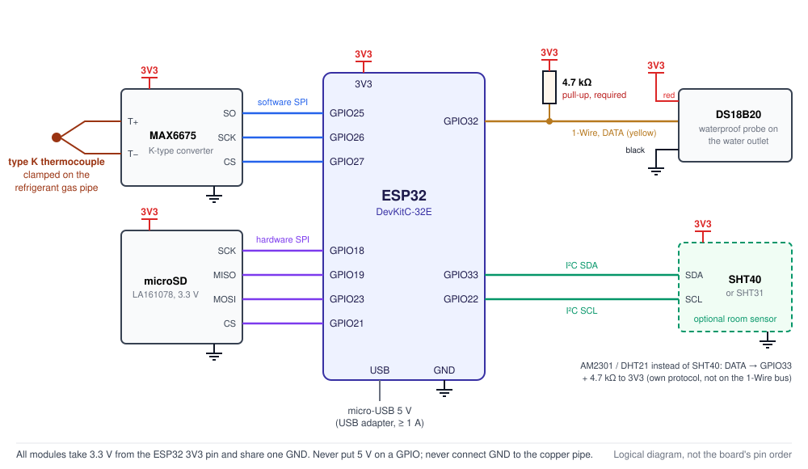

# Wiring

ESP32-DevKitC-32E + MAX6675 + LaskaKit microSD LA161078 + DS18B20 (LaskaKit LA131090) + optional room temperature and humidity sensor (SHT40 recommended, or AM2301).



## Power

The ESP32 is powered with **5 V over micro-USB** from an ordinary USB adapter (at least 1 A). All modules take **3.3 V from the `3V3` pin** of the ESP32 and share a common `GND`.

```
                         USB adapter 5 V / 1–2 A
                                   |
                            micro-USB cable
                                   |
                           ESP32-DevKitC-32E
                           (3.3 V regulator)
                                   |
                 +-----------------+-----------------+
                 |                 |                 |
                3V3               3V3               3V3
                 |                 |                 |
              MAX6675           microSD        DS18B20 (VDD)
                 |                 |                 |
                GND               GND               GND
                 +-----------------+-----------------+
                                   |
                              GND on ESP32

DS18B20 DQ (yellow) ---+---- GPIO32
                       |
                    [4.7 kΩ]
                       |
                      3V3

Room sensor (optional), one of:
  SHT40 module:  VCC -> 3V3, GND -> GND, SDA -> GPIO33, SCL -> GPIO22   (pull-ups on the module)
  AM2301:        red -> 3V3, black -> GND, yellow -> GPIO33 + [4.7 kΩ] to 3V3   (not on the DS18B20 bus)

MAX6675: SCK=GPIO26, CS=GPIO27, SO=GPIO25
microSD: SCK=GPIO18, MISO=GPIO19, MOSI=GPIO23, CS=GPIO21
```

> [!WARNING]
> Never apply a 5 V signal to the ESP32 GPIO pins. Do not connect an external 3.3 V supply while the board is powered over USB.

> [!CAUTION]
> The common `GND` is the electronics ground only. **Do not intentionally connect it to the copper refrigerant pipe.** Check whether the thermocouple junction is electrically connected to its metal body – especially when the ESP32 is plugged into a laptop over USB. See [sensor mounting](sensor-mounting.md) for details.

## MAX6675 + type K thermocouple

| MAX6675 | ESP32 |
|---|---|
| VCC | 3V3 |
| GND | GND |
| SCK | GPIO26 |
| CS | GPIO27 |
| SO / DO | GPIO25 |
| Type K thermocouple | `T+` and `T−` terminals on the MAX6675 module (mind the polarity) |

Tested with the [LaskaKit LA131099](https://www.laskakit.cz/prevodnik-max6675-termoclanek-typu-k-800c-m6-0-5m/) kit (MAX6675 module + type K probe, M6 thread, 0–800 °C, 0.5 m with metal braid). Before mounting it on a pipe, [check the probe's isolation](sensor-mounting.md#electrical-isolation-of-the-thermocouple).

The MAX6675 is read via **software SPI** on GPIO25–27, so it does not interfere with the microSD card on the hardware SPI bus.

## LaskaKit microSD LA161078

| LA161078 | ESP32 |
|---|---|
| 3V3 / VCC | 3V3 |
| GND | GND |
| SCK / CLK | GPIO18 |
| MISO / DO | GPIO19 |
| MOSI / DI | GPIO23 |
| CS / SS | GPIO21 |

The module uses 3.3 V for both power and SPI logic levels. The card must be formatted as **FAT32** (not exFAT); 4–32 GB is fine.

## DS18B20 – LaskaKit LA131090 (waterproof probe, 3 m cable)

The [LaskaKit LA131090](https://www.laskakit.cz/dallas-digitalni-vodotesne-cidlo-teploty-ds18b20-3m/) is a **bare three-wire sensor**, not a module with a built-in resistor. **You must add a 4.7 kΩ resistor.**

| Probe wire | Connect to ESP32 |
|---|---|
| red (VDD) | 3V3 |
| black (GND) | GND |
| yellow (DATA / DQ) | GPIO32 |
| **4.7 kΩ resistor** | **between GPIO32 and 3V3** |

**The resistor goes between the 3.3 V supply and the data line – it is not in series with the yellow wire.** As a pull-up it holds the 1-Wire data line at logic high whenever the sensor is not pulling it to ground. Without it, communication does not work at all, or only unreliably.

```
        ESP32                          DS18B20 probe (3 m cable)
   +------------+
   |        3V3 o---+----------------------- red (VDD)
   |            |   |
   |            | [4.7 kΩ]
   |            |   |
   |     GPIO32 o---+----------------------- yellow (DATA)
   |            |
   |        GND o--------------------------- black (GND)
   +------------+
```

- **What to buy:** an ordinary **4.7 kΩ / 0.25 W** resistor; 5 % tolerance is perfectly fine.
- **Where to put it:** at the ESP32, i.e. on the controller end of the 3 m cable. 4.7 kΩ is the right value for this cable length.
- **No firmware change is needed** for the resistor – it is purely a hardware matter.
- Probes from other manufacturers may use different wire colours; check the documentation of your particular part. If your DS18B20 is a module that already has a resistor on board, do not add another one.
- Power the sensor with three wires from 3.3 V. **Do not use parasitic power** (DATA + GND only).

## Room temperature and humidity (optional)

The firmware supports two sensors for the room where the heat pump stands, e.g. a cellar. Choose one with `CELLAR_SENSOR` at the top of [`HeatPulse.ino`](../firmware/HeatPulse/HeatPulse.ino): `CELLAR_SHT` (default – Sensirion SHT4x or SHT3x, the type is detected automatically), `CELLAR_AM2301`, or `CELLAR_NONE` when there is no sensor.

### SHT40 (recommended)

The Sensirion **SHT40** (and SHT41 / SHT45, same commands) is accurate also in very humid air (±1.8 % RH) and has a built-in heater that the firmware uses in nearly condensing air (see [usage](usage.md#room-temperature-and-humidity)). Tested choice: the [LaskaKit SHT40 module LA131037](https://www.laskakit.cz/laskakit-sht40-senzor-teploty-a-vlhkosti-vzduchu/) – 3.3 V, pull-up resistors on the board, a pin header.

| SHT40 module | Connect to ESP32 |
|---|---|
| VCC | 3V3 |
| GND | GND |
| SDA | GPIO33 |
| SCL | **GPIO22** |

- **Replacing an AM2301:** the module takes the place of the AM2301 – VCC where the red wire was, GND where the black one was, SDA where the yellow one was (GPIO33) – plus **one new wire SCL → GPIO22**. The 4.7 kΩ resistor on GPIO33 can stay (it only adds to the module's pull-up on SDA).
- **I²C address** 0x44 or 0x45 depending on the chip variant; the firmware tries both.
- **Cable:** keep the wires to the module short, up to about 1 m. The I²C bus runs at 100 kHz.
- If you break the sensor part off the LaskaKit board, its pull-ups stay on the larger part: then add 4.7 kΩ from SDA and from SCL to 3V3.
- LaskaKit also sells the SHT40 in a metal housing on a 1 m cable (LA131142; wires red VCC, black GND, yellow **SCL**, green **SDA**). The firmware works with it the same way; the page does not mention pull-ups, so add 4.7 kΩ from SDA and SCL to 3V3.

### SHT31 probe in a housing (DFRobot SEN0385)

The [DFRobot SHT31 Weather-proof probe (SEN0385)](https://wiki.dfrobot.com/SHT31_Temperature_Humidity_Sensor_Weatherproof_SKU_SEN0385) is an SHT31 (±2 % RH over 0–100 %, ±0.2 °C) in a plastic housing on a 1 m cable. The firmware detects the SHT3x by itself (`SHT3x found at I2C address 0x44` on the Serial Monitor); no setting has to be changed.

| SEN0385 wire | Connect to ESP32 |
|---|---|
| red (VCC) | 3V3 |
| black (GND) | GND |
| green (SDA) | GPIO33 |
| yellow (SCL) | GPIO22 |
| **4.7 kΩ resistor** | between GPIO33 and 3V3, and **another one between GPIO22 and 3V3** |

The manufacturer does not say whether the probe has pull-up resistors, so put them at the ESP32. If the probe has its own, the extra ones do no harm.

### AM2301 (alternative)

The AOSONG **AM2301** (also sold as **DHT21**) measures temperature and relative humidity with a single data wire. Its normal working range is only up to about 80 % RH – for a damp cellar choose the SHT40. Set `CELLAR_SENSOR = CELLAR_AM2301`.

> [!IMPORTANT]
> The AM2301 uses its **own single-wire protocol**, not Dallas **1-Wire** – even though it also has a single data wire. It **cannot share GPIO32 with the DS18B20**: it needs its own GPIO (GPIO33) and its own pull-up resistor. The OneWire library is not used for it; the firmware reads it directly.

| AM2301 wire | Connect to ESP32 |
|---|---|
| red (VDD) | **3V3** |
| black (GND) | GND |
| yellow (DATA) | GPIO33 |
| **4.7 kΩ resistor** | **between GPIO33 and 3V3** |

```
        ESP32                          AM2301
   +------------+
   |        3V3 o---+----------------------- red (VDD)
   |            |   |
   |            | [4.7 kΩ]
   |            |   |
   |     GPIO33 o---+----------------------- yellow (DATA)
   |            |
   |        GND o--------------------------- black (GND)
   +------------+
```

- **Power it from 3V3, not from 5 V.** The sensor works from 3.3 V to 5.2 V, but its data line is pulled up to its own supply. At 5 V it would put 5 V on the ESP32 GPIO.
- **Pull-up:** the same ordinary 4.7 kΩ / 0.25 W resistor as for the DS18B20, at the ESP32 end. Some AM2301 versions already have a pull-up inside; an extra 4.7 kΩ does no harm. The firmware also turns on the ESP32's weak internal pull-up, but that alone is not enough for a cable.
- **Cable length:** at 3.3 V the manufacturer recommends a short cable (about 1 m). A few metres usually work too – keep the cable away from mains cables and watch the *Failed readings* counter on the web page. If it keeps growing, shorten the cable.
- **Wire colours** can differ with other suppliers – check the documentation of your part.
- Do not read the sensor more often than every 2 s; the firmware reads it every 10 s.
- Where to place the sensor in the room: see [sensor mounting](sensor-mounting.md#room-sensor-in-the-room).

## Pin summary

| Device | Signal | ESP32 GPIO / power |
|---|---|---|
| MAX6675 | VCC | 3V3 |
| MAX6675 | GND | GND |
| MAX6675 | SCK | GPIO26 |
| MAX6675 | CS | GPIO27 |
| MAX6675 | SO | GPIO25 |
| LA161078 | 3V3 | 3V3 |
| LA161078 | GND | GND |
| LA161078 | SCK | GPIO18 |
| LA161078 | MISO | GPIO19 |
| LA161078 | MOSI | GPIO23 |
| LA161078 | CS | GPIO21 |
| DS18B20 | VDD (red) | 3V3 |
| DS18B20 | GND (black) | GND |
| DS18B20 | DQ (yellow) | GPIO32 + 4.7 kΩ resistor to 3V3 |
| SHT40 (optional) | VCC | 3V3 |
| SHT40 (optional) | GND | GND |
| SHT40 (optional) | SDA | GPIO33 |
| SHT40 (optional) | SCL | GPIO22 |
| *or* AM2301 | VDD (red) | 3V3 |
| *or* AM2301 | GND (black) | GND |
| *or* AM2301 | DATA (yellow) | GPIO33 + 4.7 kΩ resistor to 3V3 |

Pins can be changed via the `PIN_*` constants at the top of [`HeatPulse.ino`](../firmware/HeatPulse/HeatPulse.ino).

## Bench test

Before mounting the sensors on the pipes, check everything on the bench:

1. Power the ESP32 over USB and leave the thermocouple and the DS18B20 at room temperature.
2. Both sensors should show a similar temperature on the web page (a small difference is normal).
3. Warm **only the tip** of the thermocouple in your hand or carefully with a warm object – the **Refrigerant pipe** reading must rise.
4. Warm the DS18B20 in your palm – the **Outlet water** reading must rise.
5. If you use a room sensor: the **Room around the heat pump** section shows a temperature similar to the other sensors and a plausible humidity. Breathe on the sensor – the humidity must rise. *Failed readings* should stay at 0 or grow only very rarely.
6. Download the CSV and check that the temperatures and timestamps make sense.
7. Only then mount the sensors – see [sensor mounting](sensor-mounting.md).
